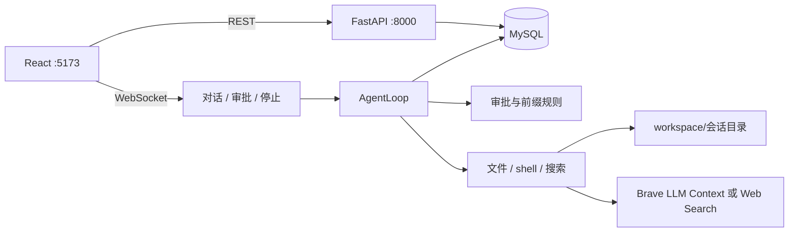

# Coding Agent 设计说明

| 项 | 值 |
| --- | --- |
| 日期 | 2026-09-29 |
| 状态 | 已按说明实现 |
| 仓库 | `/home/nehc/Projects/Coding_Agent_Project` |
| 读者 | 实现这个仓库的人 |

## 概述

本仓库做一个个人单机、单用户的 Web coding agent。用户在页面里发任务，服务用手写的 asyncio 循环调用 OpenAI 兼容的对话接口，按顺序执行工具，并把正文、思考和工具过程流式推回页面。

文件工具的路径限制在当前会话的工作目录里。批准后的 `shell` 仍以当前系统用户执行。`write`、`edit`、`shell` 先弹审批。`read`、`glob`、`grep`、`web_search` 直接执行。联网搜索只向 Brave 要标题、链接和片段。

没有登录，没有子 agent，没有 Plan / Auto 切换。后端只绑 `127.0.0.1:8000`，单进程。前端开发地址是 `127.0.0.1:5173`。

页面按 Neharness 的控制面来做，去掉工人、交互侧栏、模式切换和多供应商管理，加上明暗主题。界面用黑或白的简约样式，文案只写正常说明，不写宣传句。

## 目标与非目标

### 目标

- 一条对话可以读工作区、改文件、跑命令、联网搜索，然后用 `finish_task` 结束。
- 思考、正文、工具调用分路流式显示。写入和修改带行级 diff。
- 审批三选：本次允许、拒绝、以后都允许。以后都允许按字符串前缀放行，规则全局保存，设置页可以增删。
- 会话可新建、切换、删除。刷新或重启后，已结束的对话、工具记录和放行规则还在。
- 设置页可以改明暗和强调色、命令放行规则、模型的 `base_url` / 模型名 / `api_key`，以及保留轮数。这个数同时决定送给模型的最近轮数，和压缩时留下的原文轮数。
- 对话里有「压缩上下文」。它让模型总结保留轮数之前的记录，留下最近若干轮原文，并把总结接在系统提示后面。
- 每次操作都有可见反馈：进行中、成功、失败原因。失败不靠控制台表达。
- 测试不访问外网。搜索客户端用假的 HTTP 传输。循环用假的模型响应。

### 非目标

- 不做子 agent、工人、交互侧栏，也不做任务转包。
- 不做 Plan 模式。只有一种工作方式：能读、能改、能跑命令。
- 不做多供应商、密钥加密、Redis、Alembic、LangChain、tiktoken、命令黑名单、`allow_rules.yaml`。
- 不解析 `<think>` 标签，也不在每轮自动摘要。只有用户点「压缩上下文」时才调用模型总结。
- 不抓网页 HTML，不调用 Brave Answers。
- 不做登录、限流、多用户。不要把服务暴露到公网。
- 不承诺进程崩溃后接着跑一半的工具或还挂着的审批。

## 已定决策

1. **循环是手写的。** 每个会话一个 `AgentLoop`。一轮里：取出用户消息，拼最近历史，流式请求模型，按顺序执行工具，把工具结果写回历史，再请求模型，直到没有工具调用、调用了 `finish_task`、用户停止、轮数用尽或模型请求失败。工具返回的错误、拒绝和审批超时不结束运行。
2. **模型调用用 httpx。** `POST {base_url}/chat/completions`，`stream: true`。工具用一份手写的 JSON schema。不用 LangChain 的消息类型和 `@tool`。
3. **权威存储是 MySQL。** SQLAlchemy 2 asyncio + aiomysql。启动时 `create_all`。审批用的 Future 留在进程内存里，所以 uvicorn 必须是 `--workers 1`。
4. **放行规则全局一份。** 存在 MySQL，不按会话拆开。点「以后都允许」就追加一条。同一轮里后面的工具立刻吃到这条规则。
5. **前缀匹配做粗。** `shell` 取命令前两个词。整条命令等于该前缀，或以「前缀 + 空格」开头，就放行。不拆 `;`、`&&`、`||`。因此前缀 `echo hello` 会放行 `echo hello && rm -rf /`。`write` 和 `edit` 分开记，前缀是当时的路径字符串。`src/main.py` 会放行 `src/main.py.bak`，不会放行整个 `src/`。
6. **只读和搜索不审批。** `read`、`glob`、`grep`、`web_search`、`finish_task` 直接执行。
7. **搜索沿用旅行项目的 Brave 客户端，不沿用它的次数上限。** 先 LLM Context，账号没有该接口时再 Web Search。缓存 24 小时。不设单轮次数上限。`SEARCH_API_KEY` 只放在 `.env`。
8. **保留轮数由用户配置。** 单位是轮：从一条用户消息算起，直到下一条用户消息之前。默认 20 轮，存在 `llm_config.context_turns`，允许 1 到 200。普通请求只送最近这么多轮，更早的原文留在数据库里。同一次压缩也用这个数留下最近若干轮原文。工具结果送进模型前按字符截断。
9. **压缩留下最近若干轮原文。** 那是另一次无工具的模型调用，只总结更早的消息。历史不超过 `context_turns` 时不调用模型。成功后，请求带系统提示、整段总结，以及压缩点之后的最近 `context_turns` 轮。总结本身始终整段带上。
10. **思考通道有就显示。** 只认接口返回的 `reasoning_content`（或等价的推理字段）。折叠展示。没有就不占一块。
11. **主题在浏览器本地。** 明暗两套完整配色，外加青、绿、紫、琥珀四种强调色。默认暗色、青色。不跟系统偏好走，除非用户还没选过。

## 结构



```
Coding_Agent_Project/
  PLAN.md
  README.md
  .env.example
  .gitignore
  start.sh
  workspace/
  backend/
    pyproject.toml
    app/
      main.py
      config.py
      db.py
      models.py
      persist.py
      api/rest.py
      api/ws.py
      agent/loop.py
      agent/executor.py
      agent/stream.py
      agent/context.py
      agent/prompts.py
      tools/registry.py
      tools/files.py
      tools/shell.py
      tools/search.py
      permissions/policy.py
      permissions/gate.py
    tests/
  frontend/
    index.html
    package.json
    vite.config.ts
    src/
      main.tsx
      App.tsx
      index.css
      api/rest.ts
      api/ws.ts
      store/agentStore.ts
      store/themeStore.ts
      components/Chat.tsx
      components/SessionSidebar.tsx
      components/ToolCallCard.tsx
      components/CodeDiff.tsx
      components/ThinkingBlock.tsx
      components/ApprovalModal.tsx
      components/Settings.tsx
```

## 数据

启动建表。没有迁移历史。

| 表 | 内容 |
| --- | --- |
| `sessions` | `id`、`title`、`summary`、`compacted_before_id`、`created_at`、`updated_at`。`compacted_before_id` 指向被总结覆盖的最后一条消息，空表示还没压缩过 |
| `messages` | 会话、角色、`content`、`tool_calls` JSON、`tool_call_id`、`thinking`。按时间排列，重启后靠它恢复历史 |
| `tool_logs` | 会话、工具名、参数、结果、是否错误、耗时、决策（直接执行 / 本次允许 / 以后都允许 / 拒绝 / 超时） |
| `allow_rules` | `kind`（`shell_prefix` / `write_path` / `edit_path`）、`pattern`、`created_at`。同一 `kind + pattern` 不重复 |
| `llm_config` | 单行。`base_url`、`model`、`api_key`、`context_turns`、`updated_at`。`context_turns` 默认 20，允许 1 到 200 |
| `search_cache` | `cache_key`、`payload_json`、`fetched_at` |

标题取该会话第一条用户消息的前 40 个字。删除会话时删掉它的消息、工具日志和工作目录。放行规则不跟着删。

`llm_config` 为空时，用 `.env` 里的 `LLM_BASE_URL`、`LLM_MODEL`、`LLM_API_KEY` 插入一行。之后以数据库那行为准。接口不返回密钥，只返回是否已设置。更新时密钥留空表示不改。

## 循环

连接 WebSocket 时，如果该会话还没有循环，就建一个，并从 MySQL 装入历史。

用户消息入队。循环忙时继续排在队列里，不并行开第二个循环。停止会：

- 置停止标记，当前轮在下一步工具或下一次模型请求前退出
- 取消还在等的审批，按拒绝结束
- 杀掉这个会话正在跑的 shell 进程组

单次运行最多 50 轮模型请求。用尽后把说明写进对话并停住。

送给模型的消息：

1. 系统提示
2. 若已压缩：整段总结，放在系统提示之后，作为既有事实
3. 压缩点之后的历史里，最近 `context_turns` 轮。还没压缩过时，就在全部历史里取最近这么多轮。刚压缩成功时，这一项就是这次留下的原文
4. 本轮已经产生的助手消息和工具结果

系统提示用中文写清楚：工作目录是当前会话目录；文件工具的路径限制在这个目录里；批准后的 `shell` 仍以当前系统用户执行；网页上的事实只引用 `web_search` 返回的片段；改文件和跑命令可能要等用户点头；做完调用 `finish_task`。已有总结时再补一句：总结里的决定和文件改动视为已经发生。

## 压缩上下文

顶栏在有历史且循环空闲时显示「压缩上下文」。运行中、等待审批时不可点。历史不超过 `context_turns` 轮时也不可点，旁边写「没有更早的消息可压缩」。

这次调用不绑定工具，也不走 50 轮的工具循环。最近 `context_turns` 轮留在压缩点之后，不放进总结。输入是更早的全部消息原文，按时间排列，包括已经被上一次压缩覆盖的消息。不把上一次的总结当作输入，也不把留下的这几轮放进输入。思考字段不放进输入。单条工具结果仍按约 8000 字符头尾截断，避免这一次请求本身过大。切分按轮，不把一轮从中间切开。`compacted_before_id` 落在留下的第一轮之前的最后一条消息上。

提示要求模型写出一份能接着干活的纪要，覆盖：用户目标、已做决定、改过的文件、命令结果、未完成的事项、仍然有效的约束。不要写成对用户的寒暄。

成功后覆盖 `sessions.summary`，并把 `compacted_before_id` 设为这次纳入总结的最后一条消息 id。失败或用户停止时，原来的总结和压缩点保持不动，消息不删。

页面上，压缩点及之前的消息收进一块「已压缩的历史」，默认折叠，里面第一行是当前总结。留下的最近若干轮，以及之后新产生的消息，照常排在时间线上。会话 id 和工作目录不变。

再点一次时，按当时的 `context_turns` 重新留出结尾，把更早的原文重新总结，然后替换总结和压缩点。保留轮数后来调大，不会自动把已经压过的原文重新送进模型；要按新的轮数留出更多原文，需要再压一次。

工具结果送进模型前，超过约 8000 个字符就保留头尾并注明截断。库里的 `tool_logs.result` 同样截断，上限放宽到约 32000 个字符，避免一行把表撑爆。

模型请求失败时，这一轮记为错误，页面收到 `error`，循环回到空闲，已写入的用户消息保留。

## 流式解析

httpx 读取 SSE。每条 `data:` JSON 里：

- `delta.content` 追加到正文
- `delta.reasoning_content` 追加到思考。字段缺失则思考为空
- `delta.tool_calls` 按 `index` 拼 `id`、`name` 和参数字符串。参数字符串在工具开始前再 `json.loads`，解析失败则这个工具结果为错误，不执行

不把思考写回后续请求。助手消息回传时只带正文和 `tool_calls`。

一次模型响应结束后，没有工具调用就视为这轮说完。有工具调用就按数组顺序执行。前面的工具失败、被拒绝或审批超时，后面已经生成的调用仍照样执行。这些结果都写成 `tool` 消息，整段执行完再请求模型。拒绝、超时和工具失败都不结束这一轮。`finish_task` 执行后不再请求模型。

## 工具

路径全部相对当前会话目录解析。绝对路径、`..`、解析后不在该目录内的路径，以及指向目录外的符号链接，返回错误字符串，不抛给循环。会话目录在第一次用到时创建。

| 工具 | 参数 | 行为 |
| --- | --- | --- |
| `read` | `path` | 读文本。超过 50000 字符则截断并注明总长度。目录和缺失文件返回错误 |
| `write` | `path`、`content` | 覆盖写入。父目录不存在则创建。审批通过后执行。结果里带旧文本和新文本，供页面做 diff |
| `edit` | `path`、`old_string`、`new_string` | `old_string` 必须在文件里恰好出现一次。审批通过后替换。结果同样带 diff |
| `glob` | `pattern` | 只在会话目录内匹配。最多返回 200 条 |
| `grep` | `pattern`、可选 `path` | 正则搜索。非法正则返回错误。结果有条数上限 |
| `shell` | `command` | 在会话目录执行，`shell=True`。环境变量去掉名称里带 `API_KEY`、`SECRET`、`TOKEN`、`PASSWORD`、`MYSQL_` 的项。`HOME` 和 `PWD` 设为会话目录。超时 300 秒，超时和停止都杀进程组。stdout/stderr 流式推 `tool.progress`。最终结果带退出码 |
| `web_search` | `query`、可选 `country`、可选 `search_lang` | 见下一节 |
| `finish_task` | `message` | 把总结写进正文通道并结束运行。不审批 |

`write` / `edit` 的 diff 只服务于页面和工具日志，不再喂给模型一整份旧文件。模型看到的是短的成功或失败说明。

## 审批

需要审批时循环挂起，页面弹出当前这一条。120 秒没点，按拒绝处理，原因是超时，不写规则。拒绝和超时都不结束这一轮运行。

| 按钮 | 结果 |
| --- | --- |
| 本次允许 | 只执行这一次，不写规则 |
| 拒绝 | 不执行。工具结果是拒绝说明，模型可以换一种做法 |
| 以后都允许 | 先写规则，再执行这一次 |

`shell` 规则：去掉首尾空白，按空白切开，取前两个词，作为 `shell_prefix`。空命令不写规则，只执行这一次。

之后的命令在去掉首尾空白后，等于该前缀，或以「前缀 + 一个空格」开头，则命中。命中就不再弹窗。

`write` 的规则种类是 `write_path`，`edit` 是 `edit_path`。`pattern` 是当时参数里的 `path` 原文去掉首尾空白。之后同一工具的路径等于该字符串，或以其开头，则命中。两个工具的规则不互通。

设置页可以手添和删除。手添时做同样的非空检查，不在这里重新解释命令。

同一轮按顺序执行，就是为了让刚点下的「以后都允许」作用于本轮后面的调用。

## 联网搜索

实现放在 `tools/search.py`。主机写死为 `api.search.brave.com`。模型不能传入 URL。

模型可见参数：

- `query`：去掉空白后为空则失败。超过 600 个字符或 75 个词则失败，不打外网
- `country`：默认 `ALL`。必须是 `ALL` 或两位字母，存成大写
- `search_lang`：默认 `zh-hans`。必须匹配 `^[a-z]{2}(-[a-z]{2,8})?$`

`SEARCH_API_KEY` 为空时返回 `{ok: false, error: "未配置 SEARCH_API_KEY"}`，不打外网。

主请求：

`GET https://api.search.brave.com/res/v1/llm/context`

查询参数在上述三项之外写死：`count=5`、`maximum_number_of_urls=5`、`maximum_number_of_tokens=2048`、`maximum_number_of_snippets_per_url=3`、`context_threshold_mode=balanced`。这些不出现在工具 schema 里。

请求头：`X-Subscription-Token`、`Accept: application/json`。超时 15 秒。User-Agent 固定为 `CodingAgent/0.1 (single-user local demo)`。

回退请求仅在主请求表明账号没有 LLM Context 时发生：HTTP 404；或状态为 402、403，或 200 且正文（忽略大小写）同时不像限流文案，又包含 `plan`、`subscription`、`not subscribed`、`llm context` 之一。

`GET https://api.search.brave.com/res/v1/web/search`，只传 `q`、`country`、`search_lang`、`count=5`。

401 返回「搜索未授权」，429 返回「搜索请求过于频繁」，两者都不回退。超时返回「搜索超时」。其他失败返回「搜索服务失败」。没有可用结果返回「搜索无结果」。禁止 `{ok: true, results: []}`。

成功结果的每一项是 `title`、`url`、`snippets`。只保留 `http` / `https` 链接。片段去标签、每段最多 400 字，每条最多 3 段，总共最多 5 条。Web Search 的 `description` 收成只含一段的 `snippets`。

缓存键是查询词、国家、语言和 LLM Context 上限的 SHA-256。成功结果缓存 24 小时。另外记一条「此账号没有 LLM Context」的标记，同样 24 小时，避免每次都先付一次 404。过期视为未命中。

日志只记 `search_key_set=true/false` 和主机名，不记密钥。

配置从 `Agent_Project` 的 `backend/.env` 复制 `SEARCH_API_KEY` 到本仓库的 `backend/.env`。值不写入计划、README 和 git。

## 接口

### WebSocket `/ws?session_id=`

服务端事件：

| 事件 | 内容 |
| --- | --- |
| `session.hello` | 会话 id、标题、历史消息、当前状态。正在等待审批时，带上这一条的审批 id、工具名、参数和将要写入的前缀 |
| `agent.state` | `idle` / `running` / `awaiting_approval` / `done` / `error` |
| `message.start` | 消息 id |
| `message.delta` | `channel` 为 `content` 或 `thinking`，加增量文本 |
| `message.done` | 完整正文。有思考则一并带上 |
| `tool.start` | 工具名、参数、`tool_call_id` |
| `tool.progress` | shell 的尾部输出 |
| `tool.result` | 结果、是否错误、决策、`write`/`edit` 的 diff |
| `approval.request` | 审批 id、工具名、参数、将要写入的前缀（如果点以后都允许） |
| `approval.resolved` | 审批 id、决策 |
| `error` | 人能看懂的一句说明 |
| `compress.start` | 开始总结 |
| `compress.delta` | 总结增量 |
| `compress.done` | 完整总结，以及新的 `compacted_before_id` |
| `session.deleted` | 当前会话被删 |

客户端事件：

| 事件 | 内容 |
| --- | --- |
| `user_message` | 文本。空白消息忽略 |
| `approval.response` | `approve` / `approve_always` / `reject` |
| `stop` | 无参数。压缩进行中时同样取消这次总结 |
| `compress` | 无参数。循环空闲，且存在比保留轮数更早的消息时才接受。否则忽略，不调用模型 |

未配置模型时，`user_message` 不入循环，直接 `error`，提示去设置里填写。

### REST

| 方法 | 路径 | 作用 |
| --- | --- | --- |
| `GET` | `/health` | 进程活着 |
| `GET` `POST` | `/api/sessions` | 列表、新建 |
| `GET` `DELETE` | `/api/sessions/{id}` | 读取、删除 |
| `GET` | `/api/sessions/{id}/messages` | 历史，供刷新后首屏 |
| `GET` `PUT` | `/api/settings/llm` | 读取和更新模型配置与 `context_turns`。读取不含密钥 |
| `POST` | `/api/settings/llm/probe` | 用当前配置发一次短请求，返回成功或失败原因 |
| `GET` `POST` | `/api/settings/allow-rules` | 列表、新增 |
| `DELETE` | `/api/settings/allow-rules/{id}` | 删除一条 |

CORS 只允许 `http://127.0.0.1:5173` 和 `http://localhost:5173`。Vite 把 `/api` 和 `/ws` 代理到 `8000`。

## 前端

一页应用。左侧会话列表，中间对话，设置从顶栏打开，盖住对话而不是另做路由。

对话区：

- 用户消息、助手正文、默认收起的思考、工具卡按时间排在一条时间线里
- `write` / `edit` 的工具卡里用行级 diff
- `web_search` 的卡片列出标题。链接只渲染 `http` / `https`，`rel="noopener noreferrer"`
- shell 卡片在执行中刷新尾部输出
- 审批条出现在时间线底部，三个按钮的文案是「本次允许」「以后都允许」「拒绝」。以后都允许旁边写出将保存的前缀。刷新后如果 hello 里带有未完成的审批，审批条重新出现
- 输入框回车发送，Shift+回车换行。运行中可以停止
- 顶栏有「压缩上下文」。总结流式出现在折叠块顶部。停止对这次总结同样有效
- 靠近底部时自动跟随新内容；用户往上翻就不抢滚动

设置页三块：

- **外观**。明暗切换，以及青、绿、紫、琥珀。两套主题各自定义背景、文字、边框、面板，不靠滤镜反色。强调色单独覆盖按钮和重点。选择存在 `localStorage`
- **放行规则**。按种类列出前缀，可以添加和删除。添加后立刻对之后的工具生效
- **模型**。`base_url`、模型名、密钥，以及保留轮数。密钥空着表示不改。轮数是整数，默认 20，范围 1 到 200。这个数同时决定普通请求送出的最近轮数，以及压缩时留下的原文轮数。有「测试连接」

窄屏下会话列表收进抽屉。顶栏保留会话标题、连接状态和停止。

空会话给三句可以直接点的示例，例如列出工作目录、写一个文件、搜索一个文档问题。句子本身就是正常任务，不写成广告。

## 操作反馈

文案用平常的中文，写在触发它的控件旁边，或写在时间线里。失败保留到用户进行下一次相关操作，不闪一下就消失。按钮在请求未完成时禁用，并改成进行中的说法。控件不能用时，旁边或 `title` 写明原因。

| 操作 | 反馈 |
| --- | --- |
| 连接 | 顶栏显示连接中、已连接、已断开、连接失败。断开后自动重连，并写「正在重连」。重连成功写「已重新连接」 |
| 加载会话和历史 | 列表和对话区各有加载中。失败写原因，并给「重试」 |
| 新建会话 | 按钮变为「创建中」。成功后进入空白会话。失败留在当前会话并写原因 |
| 删除会话 | 先确认「删除这个会话和工作目录中的文件」。删除中禁用该行。成功从列表移除。删的是当前会话时回到另一个会话或空状态。失败写原因 |
| 发送 | 空白内容不发送，输入框下写「请输入内容」。未配置模型时不发送，写「请先在设置里填写模型」。发送后用户消息立即出现在时间线上。运行中输入框保留草稿，发送按钮改为停止 |
| 运行 | 顶栏状态用「运行中」「等待审批」「已完成」「出错」。出错时时间线末尾放服务端返回的那句说明 |
| 停止 | 按钮变为「正在停止」，直到状态回到空闲。停掉的那一轮在时间线写「已停止」 |
| 审批 | 弹出时顶栏为「等待审批」，三个按钮可点。点下后三个都禁用，直到 `approval.resolved`。超时在原处写「两分钟未选择，已拒绝」。拒绝、本次允许、已写入的前缀，都在对应工具卡上写明 |
| 工具 | 卡片先显示「执行中」。shell 持续刷新尾部输出。成功或失败用卡片状态区分。失败展示工具返回的错误原文，不换成笼统的「失败」 |
| 压缩 | 不可点时说明原因：没有消息，没有更早的消息可压缩，或正在运行。进行中按钮为「正在压缩」，总结区域流式增长。成功后展开折叠块的第一行，留下的最近若干轮仍排在时间线上。失败写原因，已有总结不变。停止后写「已取消压缩」 |
| 保存模型设置 | 缺 `base_url` 或模型名时不提交，字段下写缺哪一项。轮数超出 1 到 200 时写允许范围。提交中按钮为「保存中」。成功写「已保存」。密钥留空时写「密钥未改」。失败写服务端原因 |
| 测试连接 | 按钮变为「测试中」。成功写「连接成功」。失败写接口返回的原因 |
| 放行规则 | 前缀为空不提交，写「请填写前缀」。重复时写「这条规则已存在」。添加和删除都有进行中状态。成功后列表立即变化。失败写原因 |
| 外观 | 点选后整页立刻换主题或强调色。设置页标明当前是暗色或亮色、当前色名 |

工具卡和审批条上的状态属于对话记录，刷新后还在。顶栏和表单旁的短提示可以只留在当次页面里。

## 配置与启动

`backend/.env`：

| 变量 | 作用 |
| --- | --- |
| `MYSQL_HOST` `MYSQL_PORT` `MYSQL_USER` `MYSQL_PASSWORD` `MYSQL_DATABASE` | 连接本机 MySQL。库需要事先建好 |
| `LLM_BASE_URL` `LLM_MODEL` `LLM_API_KEY` | 第一次启动时写入 `llm_config` |
| `SEARCH_API_KEY` | Brave 的 `X-Subscription-Token`。可为空，为空时搜索工具直接失败 |
| `WORKDIR` | 默认 `./workspace` |

`.env.example` 里的密钥为空。`.env` 不提交。

`start.sh` 检查 `.env` 和 MySQL，再起 uvicorn（单进程）和 Vite。端口被占用时停掉旧进程再起。Ctrl+C 关掉这两个子进程。

## 测试

后端 pytest，不连真实模型和 Brave。

- 路径越界：`../`、绝对路径、目录外符号链接都被拒绝
- 前缀：`echo hello` 放行 `echo hello world` 和 `echo hello && rm -rf /`；不放行 `echo helloworld`。只有 `ls` 时不放行 `ls; rm -rf /`
- `write` 的 `src/main.py` 放行 `src/main.py.bak`，不放行 `src/other.py`，也不放行 `edit`
- 审批超时按拒绝，且不写规则
- 搜索：LLM Context 成功、套餐错误后回退 Web Search、401 和 429 不回退、缺密钥不打网络、缓存 24 小时内不重复请求、空结果是失败
- 循环：假的 SSE 依次产出正文、工具调用和结束。断言工具顺序、审批挂起、点允许后结果回填。同一次响应里前一个工具失败或被拒绝时，后一个仍执行，并且之后还会再请求模型
- 等待审批期间重连，hello 带上当前审批。没有更早消息时，`compress` 不调用模型
- 窗口：`context_turns` 为 2 时，更早的轮次不出现在模型请求里，消息表里仍在
- 压缩：最近 2 轮不进入总结输入，并出现在成功后的下一次模型请求里；更早的原文进入总结输入。历史不超过保留轮数时不调用模型。失败时总结和压缩点不变。把保留轮数调大后，已压过的原文不会自动回到下一次请求里

前端以 `tsc` 和 eslint 为检查。视觉要看暗色、亮色、审批、工具卡，以及上表里的加载、成功、失败和禁用原因。

## 实现顺序

1. 后端骨架：配置、MySQL、表、健康检查、会话 REST。
2. 文件工具和 shell，连同目录隔离。先不接模型，用单测直接打工具函数。
3. 放行规则和审批 Future。单测覆盖前缀和超时。
4. httpx 流式执行器和假 SSE 的循环测试。
5. WebSocket 把循环事件推到一个最小页面，确认能跑通一次带审批的 shell。
6. `web_search` 和搜索缓存测试。密钥从旅行项目的 `backend/.env` 抄到本地后再手工点一次真搜索。
7. 前端按本说明把时间线、diff、审批、会话列表、设置页和操作反馈做完。明暗和强调色在这一步一起做。
8. `start.sh`、`.env.example`、平实的 README。

## 已知限制

- 重启会丢掉正在等待的审批和正在跑的 shell。已经写进 MySQL 的消息还在。
- 「以后都允许」是整段命令的开头匹配，挡不住把危险命令接在已放行前缀后面。
- 这不是沙箱。工作目录限制挡的是工具参数里的路径逃逸，挡不住用户批准后的 shell 再去访问系统别的地方。
- 搜索没有单轮配额。Brave 返回 429 时，工具把「过于频繁」交回模型。
- 压缩依赖模型自己的概括。被总结的原文还在库里，但之后的请求只带总结和留下的最近若干轮。总结漏掉、又没有留在这几轮里的细节，模型就看不到，除非用户再说一遍，或再压一次。
- 保留轮数按轮计算，不按 token 计算。再压一次会把更早的全部原文送进总结请求，总长度仍可能超过模型上下文。这次请求失败时旧总结和压缩点不动。不为这个加 tokenizer。
